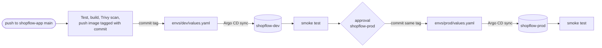

# shopflow-gitops


The desired state of every [ShopFlow](https://github.com/kirthikesh/shopflow-app) environment.
**Argo CD** watches this repository and keeps the cluster matching it: nothing is deployed with
`kubectl apply`, and a change made by hand in the cluster is reverted.

Infrastructure lives in [shopflow-infra](https://github.com/kirthikesh/shopflow-infra).

---

## How a release flows



- **Git is the only way in.** The pipeline's last action is a commit to this repo. Argo CD does the deploy.
- **Prod runs exactly what dev ran.** Promotion copies the tag dev was verified with. Nothing is rebuilt.
- **Every change is a commit.** `git log envs/prod` is the full release history, and rolling back is `git revert`.

## Layout

```
shopflow-gitops/
├── charts/shopflow/        one Helm chart: 6 services, Postgres, Redis, Mailpit, network policies
├── envs/
│   ├── dev/values.yaml     image tag (set by the pipeline on every push to main)
│   └── prod/values.yaml    image tag (set only after approval)
├── apps/shopflow.yaml      ApplicationSet: one Argo CD Application per environment
├── bootstrap/              Argo CD install (Helm, pinned version) and its settings
└── scripts/set-image.sh    point an environment at a tag and push
```

## Environments

| | dev | prod |
|---|---|---|
| Namespace | `shopflow-dev` | `shopflow-prod` |
| Updated by | every push to `main` in shopflow-app | approved "Promote to prod" stage |
| Entry point | internal load balancer (private IP) | public load balancer |
| Service Bus | its own namespace | its own namespace |
| Secrets | created by the pipeline, never in Git | created by the pipeline, never in Git |

Both run on the dev AKS cluster to keep costs down. In a real setup prod would be a separate cluster
in its own spoke (`envs/prod` in shopflow-infra); only the Argo CD destination would change.

## Use it

```bash
# Once per cluster (the app pipeline also does this automatically):
./bootstrap/install.sh

# Argo CD UI on http://localhost:8080  (user: admin)
kubectl -n argocd get secret argocd-initial-admin-secret -o jsonpath='{.data.password}' | base64 -d; echo
kubectl -n argocd port-forward svc/argocd-server 8080:80

# Release by hand, or roll back:
./scripts/set-image.sh prod <commit-sha>
git revert <release-commit> && git push
```

## Problems I hit, and how I fixed them

| Problem | Cause | Fix |
|---|---|---|
| Pipeline failed before starting: `Environment shopflow-prod could not be found` | Azure DevOps checks that every environment exists when it compiles the YAML | Created `shopflow-prod` with an approval check |
| `secure file shopflow-gitops-deploy could not be found` | The deploy key wasn't uploaded under the exact name the pipeline asks for | Uploaded the private key to Secure files as `shopflow-gitops-deploy` |
| Dev pods `Pending`, CPU 99% reserved | One 2-vCPU node; the quota for a second node is shared with the jump box. Prod and Argo CD now reserve CPU too | CPU requests cut to about 100m per environment (memory unchanged), committed here: Argo CD applied it with no pipeline run |
| `postgres-0` stayed `Pending` after that fix | A StatefulSet doesn't replace a pod that never became ready, so the old, larger request stuck | Deleted the pod; it came back with the new size |
| Dev load balancer stuck `<pending>`: `PublicIPCountLimitReached` | The subscription allows 3 public IPs per region: jump box, cluster egress and prod's load balancer | Dev uses an **internal** load balancer (private IP, smoke-tested from the agent in the hub). Only prod is public |
| First `git push` of this repo rejected | The GitHub repo was created with a README | One-time force push to the brand-new repo |

## Design decisions

- **One chart, values per environment.** Environments differ only where they should: the image tag, and whether the entry point is public. Same templates everywhere, so dev really tests what prod will run.
- **ApplicationSet instead of hand-written Applications.** Adding an environment is one line in the list.
- **Automated sync with self-heal and prune.** Drift is corrected within a minute, and nothing lingers after it's removed from Git.
- **Secrets stay out of Git.** The pipeline creates them per namespace from Azure. A later phase moves them to Key Vault with the Secrets Store CSI driver.
- **Pod-at-a-time rollouts** (`maxSurge: 0`) so an update never needs spare node capacity on the small dev cluster.
